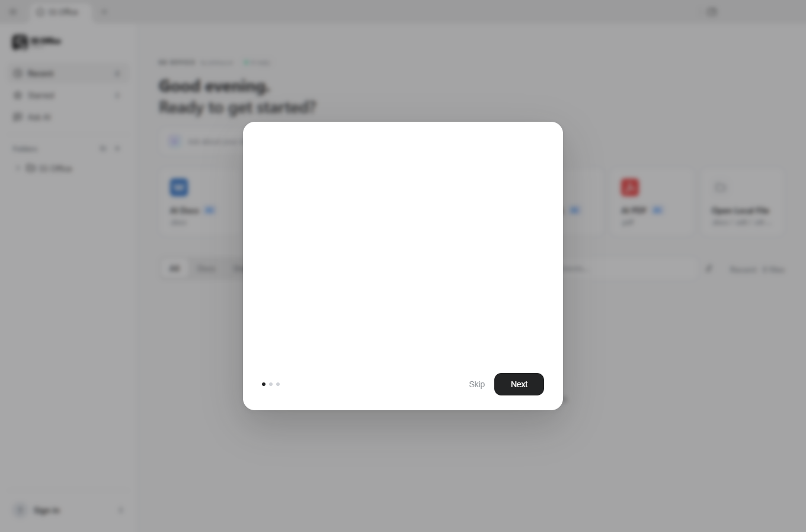

<p align="center">
  
</p>

<h1 align="center">Plot Docs</h1>

<p align="center">
  <strong>A local-first office workspace for the files you actually use.</strong><br>
  Docs, Sheets, Slides, PDF, Markdown and HTML in one desktop app.
</p>

<p align="center">
  <a href="LICENSE"></a>
  
  
</p>

<p align="center">
  <a href="#what-plot-docs-does"><b>Features</b></a> &nbsp;·&nbsp;
  <a href="#build-and-run"><b>Build</b></a> &nbsp;·&nbsp;
  <a href="#project-layout"><b>Architecture</b></a> &nbsp;·&nbsp;
  <a href="#privacy-and-security"><b>Privacy</b></a> &nbsp;·&nbsp;
  <a href="https://plotxyz.ai"><b>Plot XYZ.Ai</b></a>
</p>



Plot Docs is a desktop office suite built by **Plot XYZ.Ai**. It opens and saves
real `.docx`, `.xlsx` and `.pptx` files, works with PDFs, Markdown and HTML, and
keeps the editing experience consistent across every format.

The app is built on Electron and runs its document engines on your machine.
There is no required cloud account and no third-party identity page. A local
Plot Docs account keeps your profile on the device, while document files remain
in the folders you choose.

## What Plot Docs does

### Docs — `.docx`

A full document editor with pagination, headers and footers, sections, styles,
advanced numbering, tables, equations, comments, tracked changes, DOCX fields,
page setup, themes, validation, the page designer and PDF export.

### Sheets — `.xlsx`

Spreadsheet editing with formulas, charts, conditional formatting, data
validation, pivot tables, slicers and formula tracing. Workbooks stay in the
native Excel format and can be exported to PDF.

### Slides — `.pptx`

Presentation editing with masters, layouts, smart guides, image cropping and
speaker notes. Build decks from prompts or from the included templates, then
keep editing every slide on the canvas.

### PDF

Open and review PDFs, work with pages and annotations, and export documents
with the same layout pipeline used by the editors.

### Markdown and HTML

Edit Markdown and HTML directly, preview the result, and convert between
formats without leaving the app.

### Templates

Start from ready-made documents, workbooks, decks, PDFs, Markdown pages and
HTML pages. Templates are bundled with the desktop app and remain fully
editable after they are opened.

### AI, when you want it

The AI panel is optional. Connect **Soopus AI** or bring your own key for an
OpenAI-compatible provider, including a model running on your own machine.
AI edits can land as reviewed changes, with snapshots and rollback, instead of
silently replacing your content.

### Local search

Find files by name, folder or full text from the home screen. The index runs
locally and covers DOCX, XLSX, PPTX, PDF, Markdown and HTML files, including CJK
content.

### Command line and agent skills

The `plotdocs` command can create, read, convert, edit and render documents
without opening a window. The repository also includes agent skills for tools
such as Claude Code, Codex, Cursor, Gemini CLI, GitHub Copilot, OpenCode and
Windsurf.

## Local account

The account experience is deliberately simple and self-contained:

- **Create account** asks for a name, email and password inside the app.
- **Sign in** uses the email and password stored on this device.
- The password is saved only as a salted **scrypt** hash; plaintext passwords
  are never written to disk.
- The session persists across app restarts until you sign out.
- One local account is supported per device.
- No Google, Microsoft or other third-party sign-in page is opened for the
  Plot Docs account flow.
- There is no cloud account backend and no cross-device sync. AI provider
  credentials are configured separately in Settings.

The account file lives in Electron's `userData` directory as `account.json`.

## Build and run

### Requirements

- **Node.js 22.12 or newer**
- **npm 10 or newer**
- Windows, macOS or Linux
- Platform build tools for creating installers

### Development

```bash
git clone https://github.com/sukhee-2626/plot-docs.git
cd plot-docs
npm install
npm run dev
```

`npm run dev` starts the renderer dev servers and the Electron shell with hot
reload.

### Build the desktop app

```bash
npm run build:all
npm run shell
```

`npm run build:all` builds every editor, the CLI and the Electron shell.
`npm run shell` then launches the built app.

To work on only the shell:

```bash
npm run build -w @plotdocs/shell
npm run dev -w @plotdocs/shell
```

### Installers

```bash
# Windows
npm run dist:win

# macOS
npm run dist:mac

# Linux
npm run dist:linux
```

Packaged artifacts are written to `apps/shell/release/`. The build is currently
unsigned, so operating systems may show a SmartScreen or Gatekeeper warning.

### Tests and checks

```bash
npm run typecheck
npm test
npm run lint
npm run format:check
npm run check:theme-colors
npm run check:english-comments
```

Focused checks are faster while working on one package:

```bash
npm run typecheck -w @plotdocs/shell
npm run test -w @plotdocs/ai-search
```

### Command line

```bash
npm run build -w @plotdocs/cli
node packages/cli/dist/plotdocs.cjs --help
```

On Windows, the wrapper is `packages\cli\bin\plotdocs.cmd`.

## Project layout

| Path | Purpose |
| --- | --- |
| `apps/docs` | DOCX editor, pagination, page designer and PDF export |
| `apps/sheets` | XLSX editor, formulas, charts and validation |
| `apps/slides` | PPTX editor, layouts, masters and rendering |
| `apps/pdf` | PDF viewer and editing workflows |
| `apps/markdown` | Markdown editor and preview |
| `apps/html` | HTML editor and preview |
| `apps/shell` | Electron shell, home screen, settings, local accounts and file handling |
| `packages/docx-engine` | DOCX parsing, layout and round-trip writing |
| `packages/pptx-engine` | PPTX parsing, layout and round-trip writing |
| `packages/xlsx-gateway` | XLSX workbook engine |
| `packages/pdf2docx` | PDF-to-DOCX conversion |
| `packages/html2docx` | HTML-to-DOCX conversion |
| `packages/ai-provider` | AI provider and model configuration |
| `packages/ai-search` | Local file search, indexing and optional AI search |
| `packages/agent-core` | AI agent runtime and document operations |
| `packages/cli` | The `plotdocs` command line |
| `packages/ui` | Shared React components and design tokens |
| `packages/i18n` | Interface translations |
| `site` | Marketing and download site |
| `packaging` | Flatpak, Nix and Docker packaging files |

## Privacy and security

- Documents are opened, edited and saved on your machine.
- The local account does not require a network request.
- Passwords are salted and hashed with scrypt before being stored.
- AI requests go only to the provider you configure.
- Provider API keys are stored by the app and are not part of the local account
  file.
- The repository does not include a cloud sync service or a hosted account
  database.

See [PRIVACY.md](PRIVACY.md) for the full privacy policy.

## Contributing

Issues and pull requests are welcome. Before opening a pull request:

1. Keep changes focused and consistent with the surrounding code.
2. Run the relevant typecheck, tests and formatter.
3. Do not commit generated installers, build output or local account files.
4. Keep the Plot Docs and Soopus AI branding intact in user-facing copy.

## License

Plot Docs is released under the [Apache License 2.0](LICENSE). Third-party
components and their notices are listed in [NOTICE](NOTICE). Run
`npm run notices` after changing dependencies to regenerate the bundled
third-party notice file.

---

<p align="center">
  Built by <a href="https://plotxyz.ai">Plot XYZ.Ai</a>.
</p>
