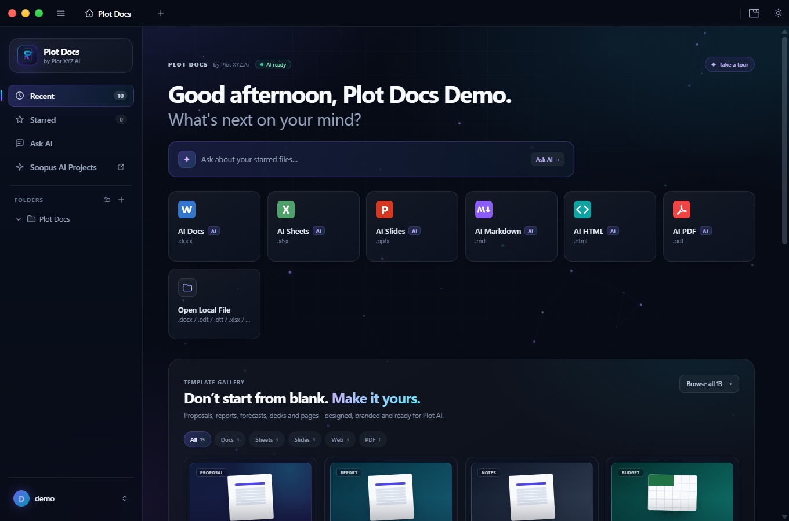
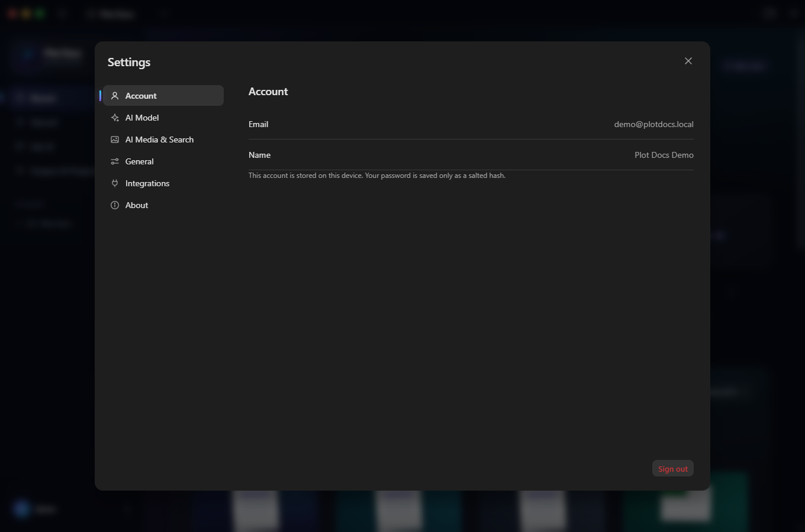
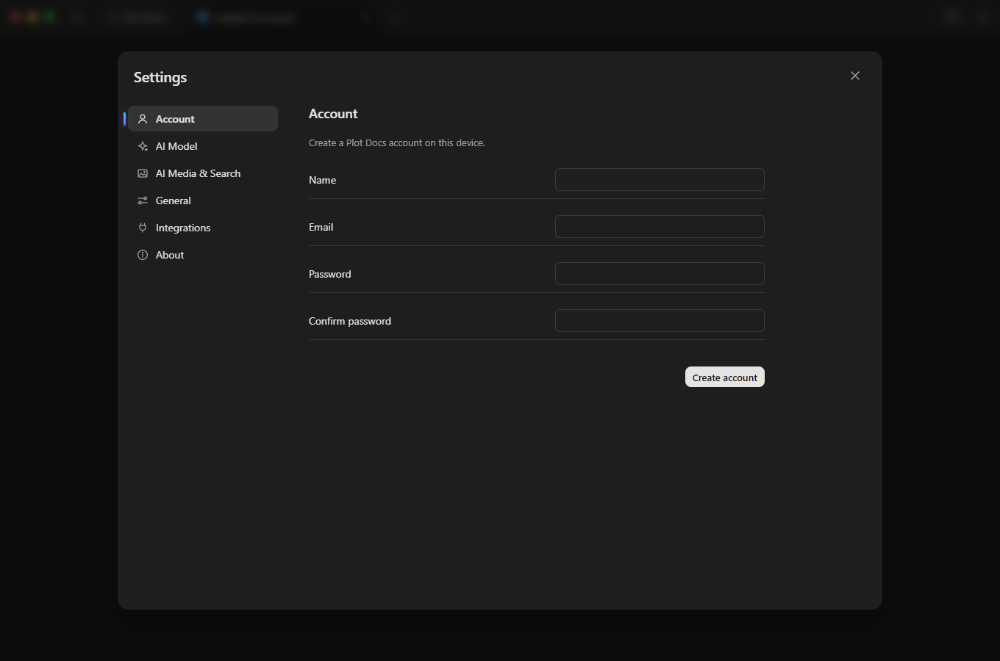
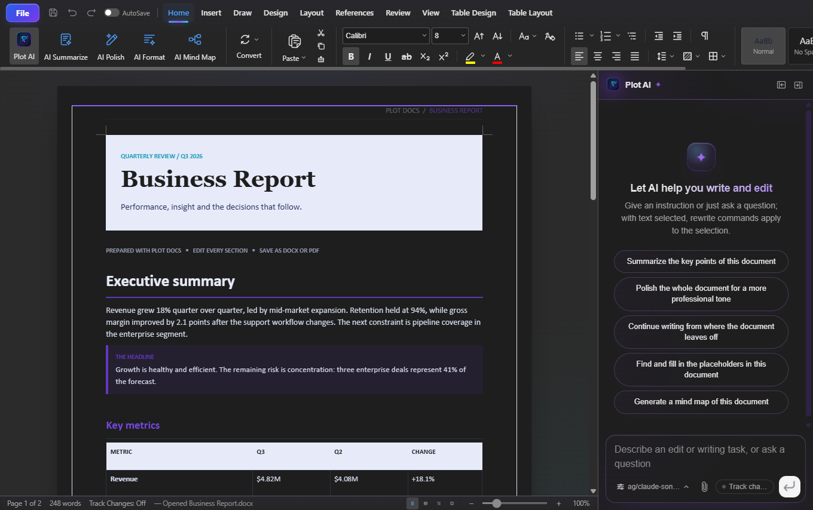
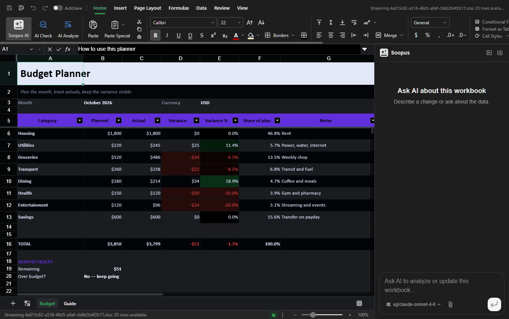
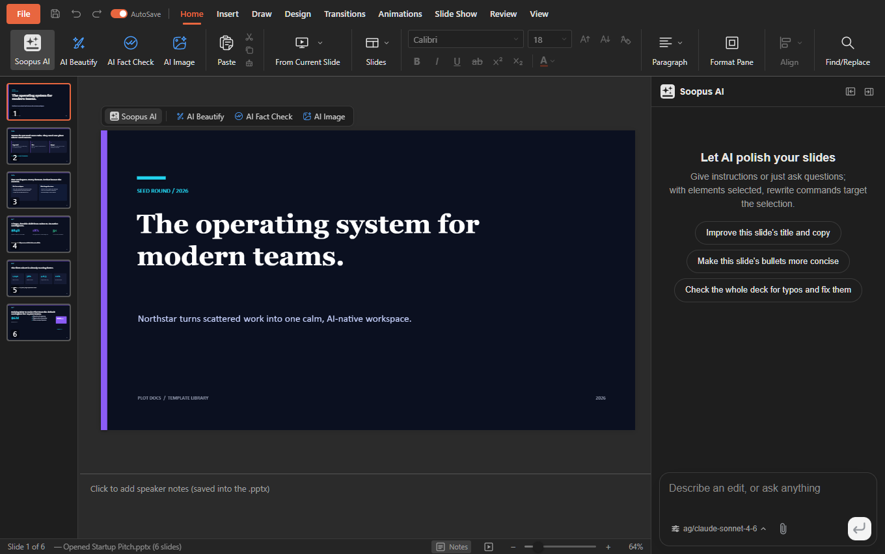
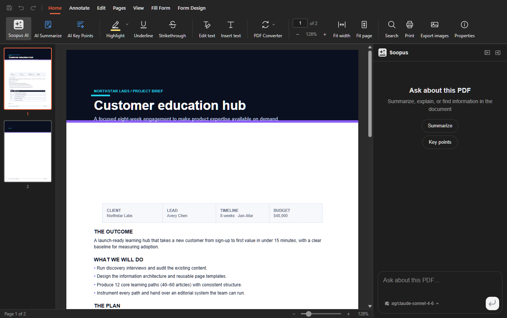
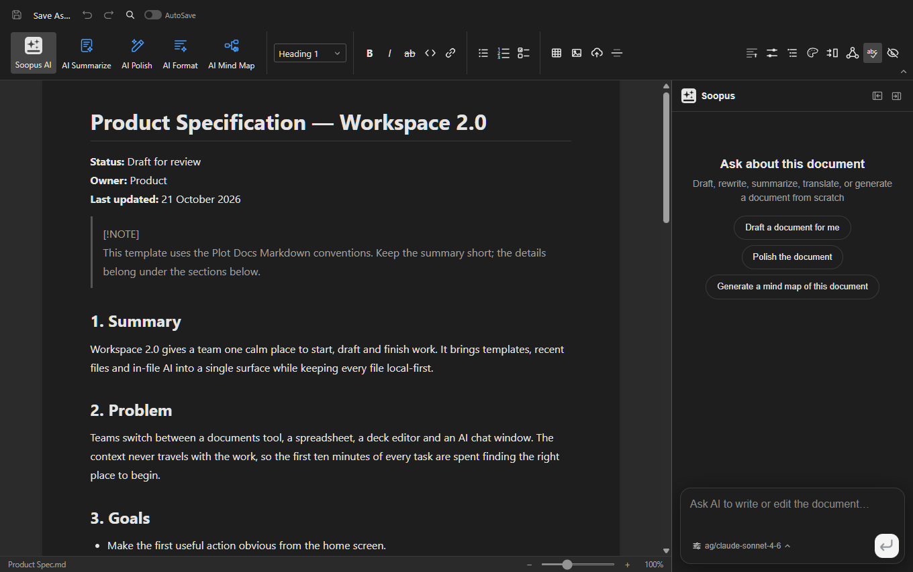
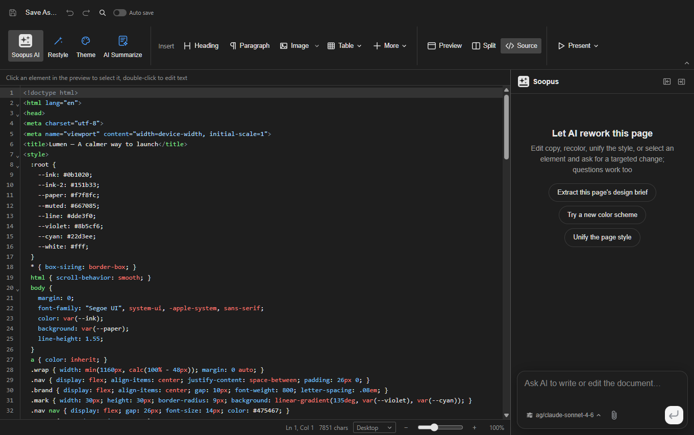
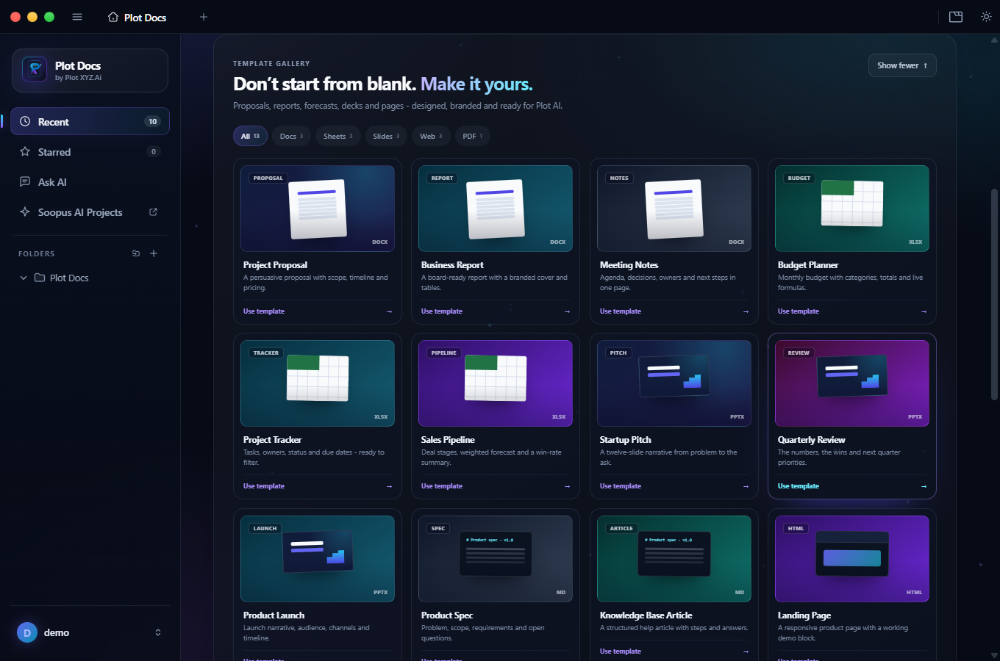

<p align="center">
  
</p>

<h1 align="center">Plot Docs</h1>

<p align="center">
  <strong>A local-first office workspace for the files you actually use.</strong><br>
  Docs, Sheets, Slides, PDF, Markdown, HTML and AI data analytics in one desktop app.
</p>

<p align="center">
  <a href="LICENSE"></a>
  
  
</p>

<p align="center">
  <a href="https://github.com/sukhee-2626/plot-docs/releases/download/v1.0.0/Plot-Docs-Setup-1.0.0.exe">
    
  </a>
</p>

<p align="center">
  <sub>Windows 10/11 · 64-bit · version 1.0.0 · unsigned build</sub>
</p>

<p align="center">
  <a href="https://github.com/sukhee-2626/plot-docs/stargazers">
    
  </a>
  &nbsp;
  <sub>If Plot Docs saves you time, <a href="https://github.com/sukhee-2626/plot-docs/stargazers">star the repository</a> — it helps other people find it.</sub>
</p>

<p align="center">
  <a href="#what-plot-docs-does"><b>Features</b></a> &nbsp;·&nbsp;
  <a href="#screenshots"><b>Screenshots</b></a> &nbsp;·&nbsp;
  <a href="#build-and-run"><b>Build</b></a> &nbsp;·&nbsp;
  <a href="#project-layout"><b>Architecture</b></a> &nbsp;·&nbsp;
  <a href="#privacy-and-security"><b>Privacy</b></a> &nbsp;·&nbsp;
  <a href="https://plotxyz.ai"><b>Plot XYZ.Ai</b></a>
</p>



Plot Docs is a desktop office suite built by **Plot XYZ.Ai**. It opens and saves
real `.docx`, `.xlsx` and `.pptx` files, works with PDFs, Markdown and HTML, and
keeps the editing experience consistent across every format.

The app is built on Electron and runs its document engines on your machine.
There is no required cloud account and no third-party identity page. A local
Plot Docs account keeps your profile on the device, while document files remain
in the folders you choose.

## Download for Windows

The README button and the link below download the Windows installer directly
from the GitHub Release:

**[Download Plot Docs 1.0.0 for Windows (installer)](https://github.com/sukhee-2626/plot-docs/releases/download/v1.0.0/Plot-Docs-Setup-1.0.0.exe)**

The build is unsigned, so Windows SmartScreen may ask you to confirm that you
want to run an app from an unknown publisher. Choose **More info → Run anyway**
if you trust this repository. The installer creates a per-user install and
keeps your documents in the folders you choose.

**SHA-256:** `C174AC3BD3B160DB9A7CA98E3408BB490CB9CFCE3E4176852B97ECC7DD5E8B02`
(154.9 MB)

## What Plot Docs does

### Docs — `.docx`

A full document editor with pagination, headers and footers, sections, styles,
advanced numbering, tables, equations, comments, tracked changes, DOCX fields,
page setup, themes, validation, the page designer and PDF export.

### Sheets — `.xlsx`

Spreadsheet editing with formulas, charts, conditional formatting, data
validation, pivot tables, slicers and formula tracing. Workbooks stay in the
native Excel format and can be exported to PDF.

### Slides — `.pptx`

Presentation editing with masters, layouts, smart guides, image cropping and
speaker notes. Build decks from prompts or from the included templates, then
keep editing every slide on the canvas.

### PDF

Open and review PDFs, work with pages and annotations, and export documents
with the same layout pipeline used by the editors.

### Markdown and HTML

Edit Markdown and HTML directly, preview the result, and convert between
formats without leaving the app.

### Templates

Start from ready-made documents, workbooks, decks, PDFs, Markdown pages and
HTML pages. Templates are bundled with the desktop app and remain fully
editable after they are opened.

### AI, when you want it

The AI panel is optional. Connect **Soopus AI** or bring your own key for an
OpenAI-compatible provider, including a model running on your own machine.
AI edits can land as reviewed changes, with snapshots and rollback, instead of
silently replacing your content.

### AI Data Analytics

Open **AI Data Analytics** from Home (between AI PDF and Open Local File) for a
local-first analytics workspace with a persistent Plot AI side panel. Import a
CSV, TSV, JSON, XLSX or XLSM file, connect SQLite, PostgreSQL or MySQL, or paste
a public link. Plot AI also reads HTML tables and follows a page that links to a
CSV, TSV, JSON or XLSX file.

The workspace profiles every dataset and shows rows, columns, nulls, distinct
values, duplicate rows and a transparent quality score. You can inspect and
edit the inferred schema, clean data with a reversible backup, run read-only
SQL, use a fixed safe Python aggregation, build charts, save live dashboard
cards and export exact query results as CSV.

**Full automation.** Choose **Run full auto** and the deterministic local engine
will:

1. remove exact duplicate rows with a one-step undo;
2. profile the dataset and measure missingness;
3. rank the strongest text dimension by a numeric metric, using a windowed
   total so the top group's share is calculated across every group;
4. build a time trend when a date column exists;
5. create an equal-width distribution histogram;
6. calculate both Pearson and Spearman correlation, then select the rank
   correlation when the monotonic signal is materially stronger than the
   linear fit;
7. find 1.5×IQR outliers;
8. fit an ordinary least-squares linear forecast with slope, R², residual
   standard error, an approximate 95% slope confidence interval and an
   approximate 95% prediction interval; and
9. save every eligible chart as a live **Auto ·** dashboard card with its SQL.

Every insight shows its calculation or SQL, the method used, the dataset it
used, the exact result rows, the time period or dimension involved, a
confidence label, a plain-language meaning and the uncertainty caveat. If a
calculation cannot run, it is omitted instead of guessed. No result is
fabricated, and the local engine does not need an AI model.

**Dataset understanding.** Before a full run, Plot AI can read the schema,
column profiles and sample rows to identify what one row represents (the grain),
the likely role of each column, the best metric, dimension and time axis, useful
questions and reversible preparation. Every model choice is validated against
the real imported schema; invalid columns, analyses or cleaning steps are
replaced with a deterministic local reading. The **Data** and **Automate** tabs
show the plan, its source and its caveats, so you can see what the automation
understood before trusting the results.

**Plot AI assistant.** The side panel works like the document-creation chat. It
can import a source, prepare the dataset, run SQL, rank and sort groups, predict
a date trend, save a dashboard card or run the whole pipeline. Ranking returns
the exact windowed SQL and a full-group share; prediction returns the slope, R²,
a slope interval and an approximate prediction interval instead of a single
unqualified number. When an AI provider is connected, the model plans those
steps and the app executes them locally. When no model is connected, or the
model call fails, Plot AI uses the same local automation engine and says so in
the reply. The assistant cannot delete datasets, export files, run arbitrary
code or issue write SQL.

**Data limits and safety.** Files are limited to 100 MB and 250,000 rows; scraped
HTML pages are limited to 20 MB. URL import accepts only public http/https
addresses, blocks localhost and private IP ranges, follows at most four
redirects, applies a 30-second timeout and allows ports 80, 443, 8080 and 8443.
Python is restricted to a fixed app-generated aggregation, runs in isolated mode
with a 20-second timeout and never accepts arbitrary user code. Forecasting is a
transparent linear least-squares fit, not a causal model; its prediction
interval is an approximate uncertainty band that widens outside the observed
range. Scheduled refreshes, external destinations and team approval queues are
not enabled yet.

### Local search

Find files by name, folder or full text from the home screen. The index runs
locally and covers DOCX, XLSX, PPTX, PDF, Markdown and HTML files, including CJK
content.

### Command line and agent skills

The `plotdocs` command can create, read, convert, edit and render documents
without opening a window. The repository also includes agent skills for tools
such as Claude Code, Codex, Cursor, Gemini CLI, GitHub Copilot, OpenCode and
Windsurf.

## Screenshots

<table>
  <tr>
    <td width="50%" align="center">
      <br>
      <sub><b>Home</b> — recent files, search and one-click new documents</sub>
    </td>
    <td width="50%" align="center">
      <br>
      <sub><b>Local account</b> — name, email and device-only session</sub>
    </td>
  </tr>
  <tr>
    <td width="50%" align="center">
      <br>
      <sub><b>Create account</b> — no third-party identity page</sub>
    </td>
    <td width="50%" align="center">
      <br>
      <sub><b>Docs</b> — pagination, formatting, page design and AI review</sub>
    </td>
  </tr>
  <tr>
    <td width="50%" align="center">
      <br>
      <sub><b>Sheets</b> — formulas, charts, validation and native XLSX files</sub>
    </td>
    <td width="50%" align="center">
      <br>
      <sub><b>Slides</b> — masters, layouts, notes and on-canvas editing</sub>
    </td>
  </tr>
  <tr>
    <td width="50%" align="center">
      <br>
      <sub><b>PDF</b> — open, review and work with pages</sub>
    </td>
    <td width="50%" align="center">
      <br>
      <sub><b>Markdown</b> — edit and preview in one place</sub>
    </td>
  </tr>
  <tr>
    <td width="50%" align="center">
      <br>
      <sub><b>HTML</b> — source editing with a rendered preview</sub>
    </td>
    <td width="50%" align="center">
      <br>
      <sub><b>Templates</b> — editable starting points for every editor</sub>
    </td>
  </tr>
</table>

## Local account

The account experience is deliberately simple and self-contained:

- **Create account** asks for a name, email and password inside the app.
- **Sign in** uses the email and password stored on this device.
- The password is saved only as a salted **scrypt** hash; plaintext passwords
  are never written to disk.
- The session persists across app restarts until you sign out.
- One local account is supported per device.
- No Google, Microsoft or other third-party sign-in page is opened for the
  Plot Docs account flow.
- There is no cloud account backend and no cross-device sync. AI provider
  credentials are configured separately in Settings.

The account file lives in Electron's `userData` directory as `account.json`.

## Build and run

### Requirements

- **Node.js 22.12 or newer**
- **npm 10 or newer**
- Windows, macOS or Linux
- Platform build tools for creating installers

### Development

```bash
git clone https://github.com/sukhee-2626/plot-docs.git
cd plot-docs
npm install
npm run dev
```

`npm run dev` starts the renderer dev servers and the Electron shell with hot
reload.

### Build the desktop app

```bash
npm run build:all
npm run shell
```

`npm run build:all` builds every editor, the CLI and the Electron shell.
`npm run shell` then launches the built app.

To work on only the shell:

```bash
npm run build -w @plotdocs/shell
npm run dev -w @plotdocs/shell
```

### Installers

```bash
# Windows
npm run dist:win

# macOS
npm run dist:mac

# Linux
npm run dist:linux
```

Packaged artifacts are written to `apps/shell/release/`. The build is currently
unsigned, so operating systems may show a SmartScreen or Gatekeeper warning.

### Tests and checks

```bash
npm run typecheck
npm test
npm run lint
npm run format:check
npm run check:theme-colors
npm run check:english-comments
```

Focused checks are faster while working on one package:

```bash
npm run typecheck -w @plotdocs/shell
npm run test -w @plotdocs/ai-search
```

### Command line

```bash
npm run build -w @plotdocs/cli
node packages/cli/dist/plotdocs.cjs --help
```

On Windows, the wrapper is `packages\cli\bin\plotdocs.cmd`.

## Project layout

| Path | Purpose |
| --- | --- |
| `apps/docs` | DOCX editor, pagination, page designer and PDF export |
| `apps/sheets` | XLSX editor, formulas, charts and validation |
| `apps/slides` | PPTX editor, layouts, masters and rendering |
| `apps/pdf` | PDF viewer and editing workflows |
| `apps/markdown` | Markdown editor and preview |
| `apps/html` | HTML editor and preview |
| `apps/shell` | Electron shell, home screen, settings, local accounts and file handling |
| `packages/docx-engine` | DOCX parsing, layout and round-trip writing |
| `packages/pptx-engine` | PPTX parsing, layout and round-trip writing |
| `packages/xlsx-gateway` | XLSX workbook engine |
| `packages/pdf2docx` | PDF-to-DOCX conversion |
| `packages/html2docx` | HTML-to-DOCX conversion |
| `packages/ai-provider` | AI provider and model configuration |
| `packages/ai-search` | Local file search, indexing and optional AI search |
| `packages/agent-core` | AI agent runtime and document operations |
| `packages/cli` | The `plotdocs` command line |
| `packages/ui` | Shared React components and design tokens |
| `packages/i18n` | Interface translations |
| `site` | Marketing and download site |
| `packaging` | Flatpak, Nix and Docker packaging files |

## Privacy and security

- Documents are opened, edited and saved on your machine.
- The local account does not require a network request.
- Passwords are salted and hashed with scrypt before being stored.
- AI requests go only to the provider you configure.
- Provider API keys are stored by the app and are not part of the local account
  file.
- The repository does not include a cloud sync service or a hosted account
  database.

See [PRIVACY.md](PRIVACY.md) for the full privacy policy.

## License

Plot Docs is released under the [Apache License 2.0](LICENSE). Third-party
components and their notices are listed in [NOTICE](NOTICE). Run
`npm run notices` after changing dependencies to regenerate the bundled
third-party notice file.

---

<p align="center">
  Built by <a href="https://plotxyz.ai">Plot XYZ.Ai</a>.
</p>
