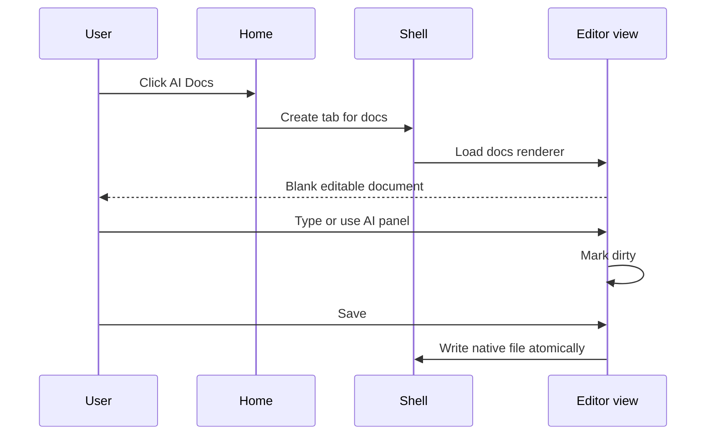
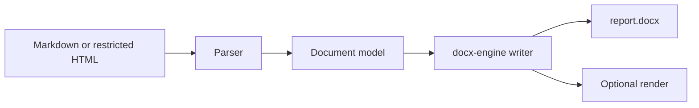
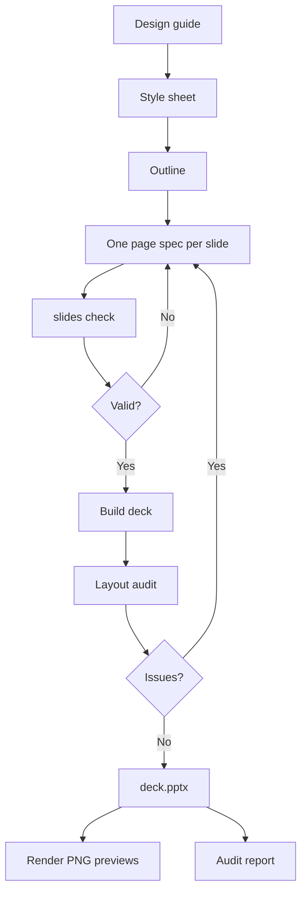
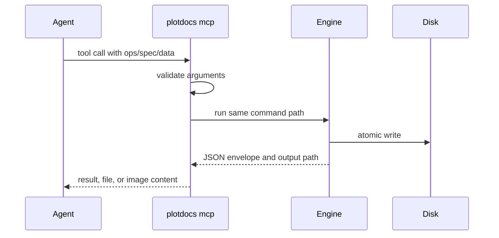
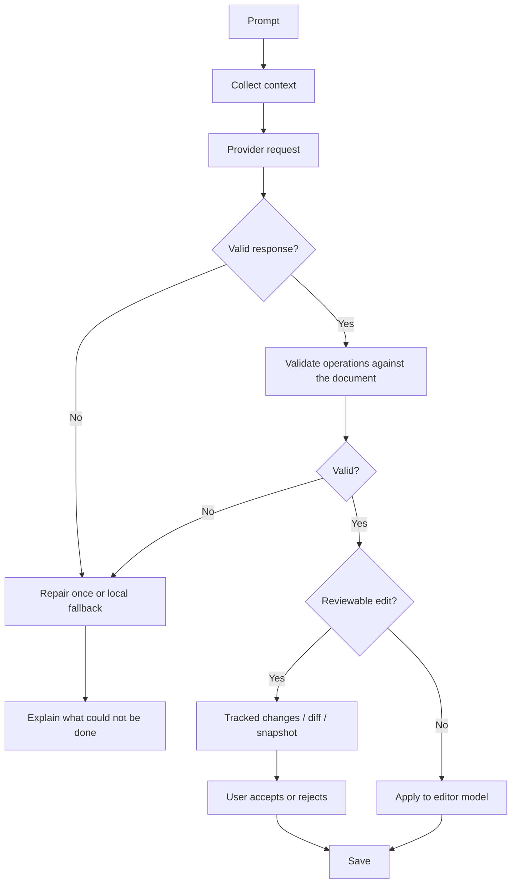

# Document Generation Methods

Plot Docs can create and change documents from the desktop UI, from the AI panel, from the `plotdocs` command line, and from an MCP client. All paths use the same document engines and the same validation rules, so a generated file remains a normal, editable Plot Docs file.

This guide explains each method, its inputs and outputs, and the exact pipeline behind it.

## 1. Method chooser

| You want to... | Use | Input | Output |
| --- | --- | --- | --- |
| Start a blank document, workbook or deck | Home quick-create card | A click | New editor tab |
| Start from a designed file | Templates | Template selection | Editable native file |
| Edit an existing file | Open Local File, recent file, or argv | `.docx`, `.xlsx`, `.xlsm`, `.pptx`, `.pdf`, `.md`, `.html` | Edited native file |
| Ask AI to draft or change content | AI panel | Prompt and document context | Reviewed edits or generated content |
| Create a document from Markdown or HTML | CLI `create` | `.md` or restricted HTML | `.docx` |
| Create a workbook from a table | CLI `create` | 2-D JSON array, `{sheets:[...]}`, or CSV | `.xlsx` |
| Create a deck from a design | CLI `create --type pptx` | Ops JSON, or a staged deck directory | `.pptx` plus optional PNGs and audit |
| Fill a template | CLI `merge` | DOCX/PPTX/XLSX template and JSON data | Filled file |
| Convert a file | CLI `convert` | Existing file | Another format |
| Apply structured edits | CLI `docs apply`, `sheet apply`, `slides apply` | Ops/cells JSON | Updated file |
| Render pages to images | CLI `render` or `slides render` | Any supported document | PNG per page |
| Let an agent do the work | MCP server | MCP tool call | JSON result, file, or PNG |

## 2. Desktop UI generation

### 2.1 Home quick-create

The Home screen has six AI quick-create cards:

1. AI Docs
2. AI Sheets
3. AI Slides
4. AI Markdown
5. AI HTML
6. AI PDF

The seventh card opens a local file. A quick card creates a blank editor tab and focuses the editor. The AI panel is optional; a user can ignore it and type directly.



### 2.2 Templates

Templates are bundled with the app. Opening one creates a normal editable file; nothing is locked. Templates exist for documents, workbooks, decks, PDFs, Markdown and HTML.

### 2.3 AI panel

The AI panel is available in each editor. It uses the shared model picker and the configured provider. AI edits can be applied as reviewed changes, with snapshots and rollback, rather than silently replacing content.

Typical inputs:

- A prompt such as "Create a one-page project brief with a summary table".
- The current document or selection as context.
- Optional attachments or references.

Typical outputs:

- A new document, section, slide or sheet range.
- A tracked-change set or diff for review.
- A plain-language explanation or summary.

The model never bypasses the editor's validation. Invalid document operations are rejected and reported with a guided error.

## 3. CLI generation

The CLI is built from `packages/cli` and runs on the app's Node runtime in a packaged install. In a checkout:

```powershell
npm run build -w @plotdocs/cli
node packages/cli/dist/plotdocs.cjs --help
```

Every command prints a one-line human summary by default, or one JSON object with `--json`:

```json
{
  "status": "ok",
  "command": "create",
  "summary": "Created report.docx",
  "output_path": "report.docx",
  "warnings": [],
  "detail": {}
}
```

Errors return `{ status: "error", code, error, message, suggestion, detail }`. Exit codes: `0` ok, `1` usage, `2` file, `3` conversion failed, `4` app not available.

### 3.1 Create a DOCX

From Markdown:

```powershell
plotdocs create --type docx --from report.md --out report.docx
```

From restricted HTML:

```powershell
plotdocs create --type docx --from fragment.html --out report.docx
```



### 3.2 Create an XLSX

From a 2-D JSON array:

```json
[
  ["Name", "Score"],
  ["Ada", 98],
  ["Linus", 95]
]
```

```powershell
plotdocs create --type xlsx --from table.json --out book.xlsx
```

From multiple sheets:

```json
{
  "sheets": [
    { "name": "Data", "rows": [["Name", "Score"], ["Ada", 98]] },
    { "name": "Notes", "rows": [["Generated by Plot Docs"]] }
  ]
}
```

From CSV:

```powershell
plotdocs create --type xlsx --from data.csv --out data.xlsx --header
```

`=...` cells become formulas. ISO dates become real date cells. A `sep=` line in CSV is honored.

### 3.3 Create a PPTX

Two methods are supported.

**Ops JSON** — the same ops the in-app AI uses:

```powershell
plotdocs create --type pptx --ops deck.json --out deck.pptx
```

**Staged deck spec** — the app's design pipeline:

```powershell
plotdocs create --type pptx --spec deck/pages --outline deck/outline.json --out deck.pptx
```

With rendering and audit:

```powershell
plotdocs create --type pptx --spec deck/pages --outline deck/outline.json --out deck.pptx --render deck/previews --audit
```

The staged flow is:



Useful companion commands:

```powershell
plotdocs guide slides design
plotdocs guide slides spec
plotdocs slides check deck/outline.json
plotdocs slides check deck/pages/03.json
plotdocs slides replace deck.pptx --slide 2 --spec deck/pages/03.json
plotdocs slides audit deck.pptx --json
plotdocs slides render deck.pptx --out shots/ --scale 2
```

### 3.4 Convert files

```powershell
plotdocs convert scan.pdf --to docx
plotdocs convert data.csv --to xlsx --out out/data.xlsx
plotdocs convert notes.md --to docx
plotdocs convert report.docx --to html
plotdocs convert page.html --to docx
plotdocs convert report.docx --to md
plotdocs convert book.xlsx --to csv --sheet Data
```

Conversion paths:

| From | To | Engine |
| --- | --- | --- |
| PDF | DOCX | `@plotdocs/pdf2docx` |
| HTML | DOCX | `@plotdocs/html2docx` |
| DOCX | HTML | Docs editor standalone HTML export |
| DOCX | Markdown | Markdown editor serializer |
| Markdown | DOCX / HTML / PDF | Docs/Markdown pipelines |
| XLSX | CSV / PDF | xlsx-gateway and export pipeline |
| DOCX / XLSX / PPTX / HTML / Markdown | PDF / PNG | Hidden app renderer |

### 3.5 Read and edit documents

```powershell
plotdocs docs read report.docx --json
plotdocs docs read report.docx --range 0-9 --html --comments --revisions --header-footer --properties --json
plotdocs docs apply report.docx --ops ops.json
plotdocs docs apply report.docx --ops ops.json --dry-run
plotdocs docs check report.docx --json
```

`docs apply` supports:

- `apply_ops` entries
- `insert_content`
- `replace_blocks`
- `insert_image`
- `insert_chart`
- `edit_chart`
- `set_header_footer`
- `reply_comment`
- `resolve_comment`
- `set_properties`

`docs check` reports fields without results, broken bookmark references, stale TOC, missing images, empty charts/headings, heading-level skips, placeholder text, pending revisions and open comments.

### 3.6 Read and edit workbooks

```powershell
plotdocs sheet read book.xlsx --json
plotdocs sheet read book.xlsx --sheet Data --range A1:D20 --formats --json
plotdocs sheet apply book.xlsx --cells cells.json
plotdocs sheet apply book.xlsx --ops ops.json --dry-run
plotdocs sheet check book.xlsx --json
```

Workbook DSL ops cover cells, formats, charts, tables, filters, conditional formats, validation, links, notes, panes, page setup, sheets, pivots and sparklines. Only operations that need a live editor session are refused headless; those are documented in the CLI README.

### 3.7 Merge a template

```powershell
plotdocs merge invoice-template.docx --data values.json --out invoice.docx
plotdocs merge invoice-template.pptx --data values.json --out deck.pptx
plotdocs merge budget-template.xlsx --data values.json --out budget.xlsx
```

The merge fills `{{key}}` placeholders. Nested objects flatten to dotted keys (`{{a.b}}`); arrays are reported as ignored. The result lists `used_keys`, `unused_keys` and `unresolved_placeholders`, with location details. `--strict` turns unresolved placeholders into an error and writes nothing. Output is atomic; an existing file needs `--force`.

### 3.8 Render pages and elements

```powershell
plotdocs render report.docx --out shots/
plotdocs render book.xlsx --out shots/ --page 3 --scale 2
plotdocs render page.html --out shots/
plotdocs render file.pdf --out shots/
plotdocs render deck.pptx --out shots/ --el e_12 --pad 16
plotdocs render deck.pptx --out shots/ --grid --cols 4 --tile 320
```

Rendering uses the same layout and PDF pipeline as the app. `--el` crops a page to a durable element id; `--grid` makes a contact sheet.

## 4. MCP generation

`plotdocs mcp` exposes the same commands as MCP tools:

```powershell
plotdocs mcp
plotdocs mcp --http 3000 --host 127.0.0.1 --token secret
plotdocs mcp install all
plotdocs mcp list
```

The tool table is generated from the CLI registry, so the CLI and MCP surfaces cannot drift. Ops, cell lists, specs and Markdown are passed inline and land in a scratch directory for the duration of the call. `render` and `slides_render` return PNGs as image content. Results use the same JSON envelope as `--json`.



## 5. AI update and review flow



Rules:

- The model cannot invent document structure that the engine rejects.
- The model cannot run arbitrary code.
- Analytics model output is validated against the real schema.
- AI edits can be rolled back through snapshots.
- A failed model call never blocks manual editing.

## 6. Input and output reference

| Format | Open | Create | Save / export | Read headless |
| --- | --- | --- | --- | --- |
| DOCX | Yes | Markdown, HTML, ops, merge | DOCX, PDF, HTML, Markdown | `docs read` |
| XLSX / XLSM | Yes | JSON, CSV, cells, ops, merge | XLSX/XLSM, CSV, PDF | `sheet read` |
| PPTX | Yes | Ops, staged spec, merge | PPTX, PDF, PNG | `slides read` |
| PDF | Yes | Render from any document | PDF, PNG, DOCX | `pdf read` |
| Markdown | Yes | Editor, AI, text | MD, HTML, DOCX, PDF | Editor / CLI convert |
| HTML | Yes | Editor, AI, text | HTML, DOCX, PDF | Editor / CLI convert |
| CSV | Sheets import, analytics import | Sheets create | CSV | CLI / analytics |
| JSON | Analytics import, CLI ops/data | CLI create/merge | JSON | CLI |

## 7. Testing a generation method

Use the smallest check that proves the real path:

```powershell
# Build the app used by Playwright
npm run build:all

# A real UI-created document
npx playwright test e2e/new-file-tab.spec.ts --config e2e/playwright.config.ts

# Real editor round-trips
npx playwright test e2e/markdown-tab.spec.ts e2e/html-tab.spec.ts --config e2e/playwright.config.ts

# CLI
npm run build -w @plotdocs/cli
node packages/cli/dist/plotdocs.cjs create --type docx --from README.md --out test.docx --json
```

The page-by-page matrix and current results are in [`../development-docs/10-document-generation-test-matrix.md`](../development-docs/10-document-generation-test-matrix.md).
