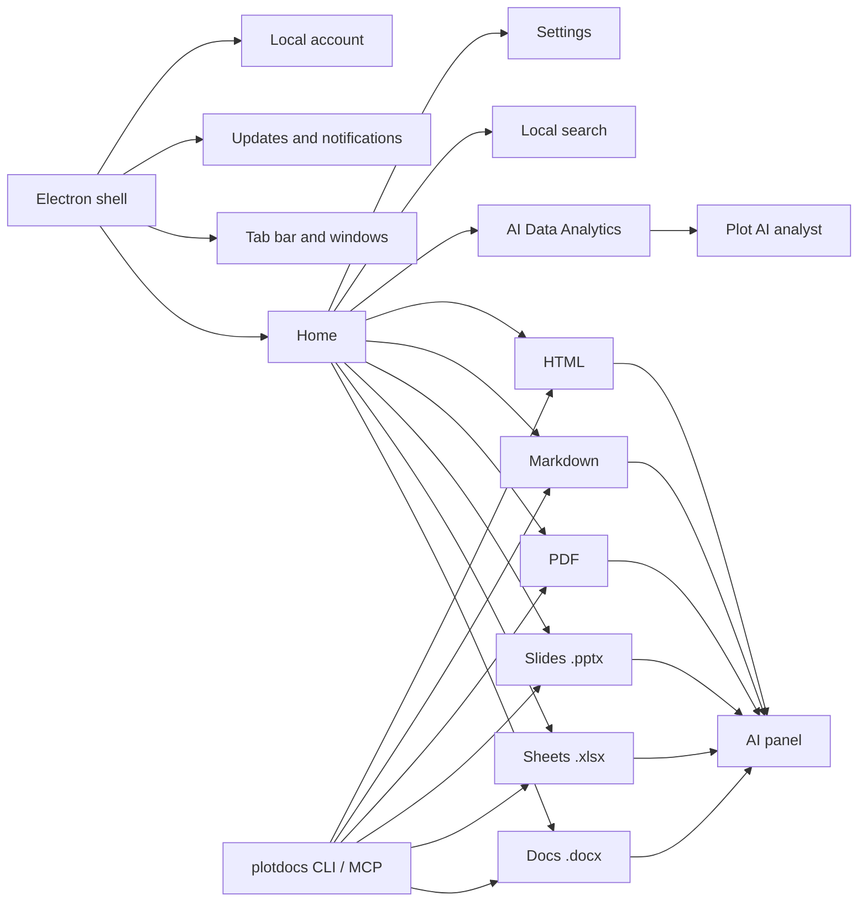
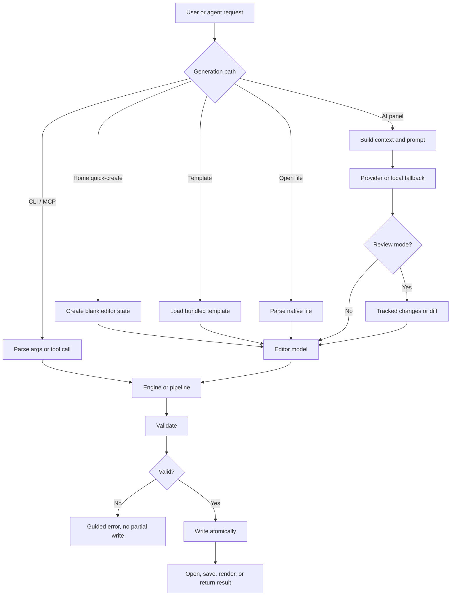
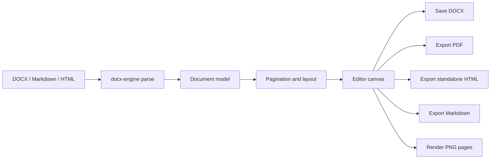
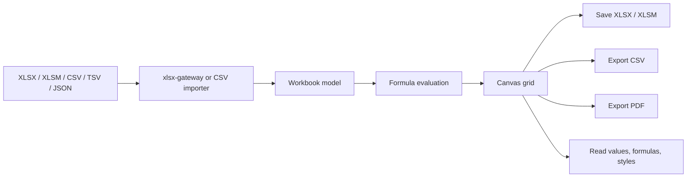
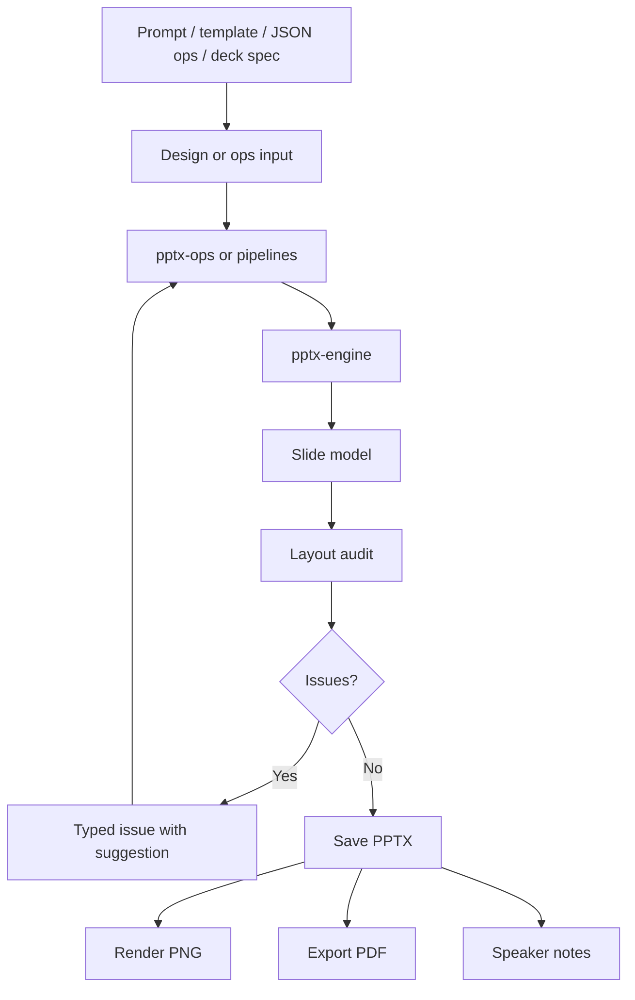
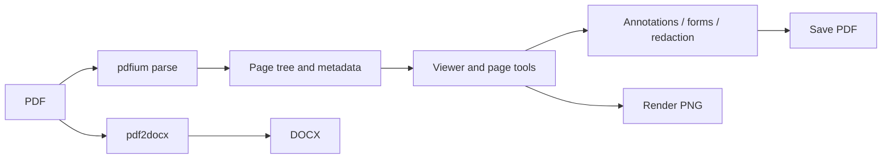
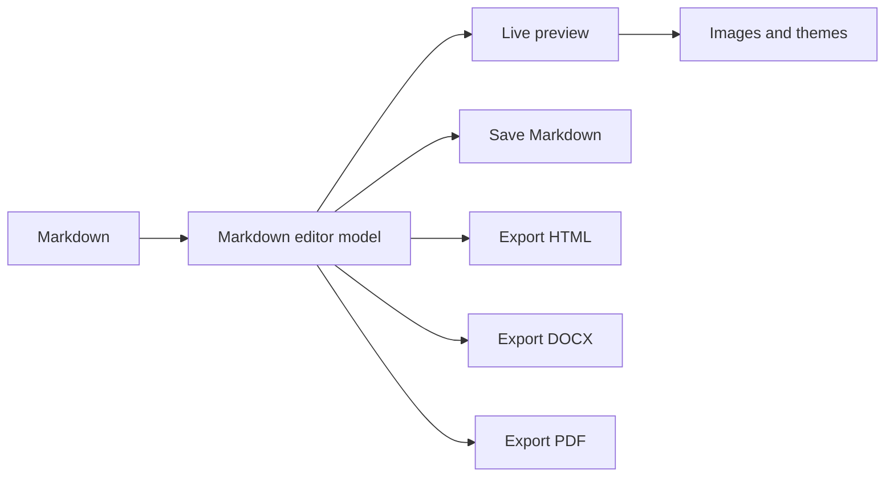
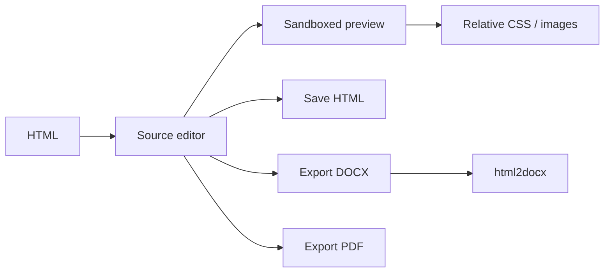
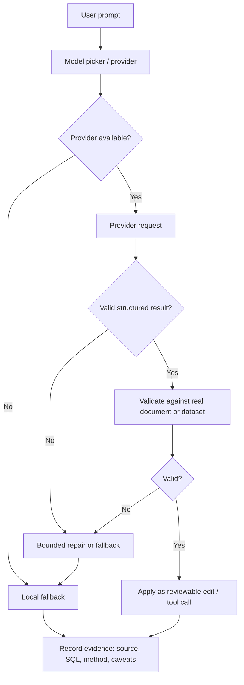

# Plot Docs Feature Catalog

This is the single-page map of Plot Docs. It covers the user-facing surfaces, document-generation methods, inputs and outputs, AI behavior, updates and notifications, analytics, CLI/MCP, and the evidence behind each claim.

Status words used here:

- **Implemented** — code and UI exist.
- **Verified** — exercised by a focused automated test or a recorded real run.
- **Partial** — useful implementation with a named gap.
- **Not implemented** — no working capability yet.

The detailed analytics feature matrix is in [`implementation/feature-matrix.md`](implementation/feature-matrix.md). Update and notification details are in [`updates-and-notifications.md`](updates-and-notifications.md) and [`github-update-notification-flow.md`](github-update-notification-flow.md).

## 1. Product map

| Surface | What it does | Main inputs | Main outputs |
| --- | --- | --- | --- |
| Home | Recent files, folders, search, templates, quick-create cards, AI Data Analytics entry | Local files and folders | Editor tabs, analytics workspace |
| Docs | Word-compatible document editing, pagination, page design, review, export | `.docx`, `.md`, `.html`, text, images, tables, charts | `.docx`, PDF, standalone HTML, Markdown |
| Sheets | Spreadsheet editing, formulas, charts, validation, pivot tables, slicers | `.xlsx`, `.xlsm`, `.csv`, `.tsv`, clipboard data | `.xlsx`, `.xlsm`, CSV, PDF |
| Slides | Presentation editing, masters, layouts, notes, on-canvas editing | `.pptx`, templates, prompts, JSON op specs | `.pptx`, PDF, PNG |
| PDF | PDF viewing, page tools, forms, annotations, redaction workflows | `.pdf` | `.pdf`, PNG, converted documents |
| Markdown | Markdown source editing and live preview | `.md`, text | `.md`, HTML, DOCX, PDF |
| HTML | HTML source editing, preview, restricted HTML insertion | `.html`, text | `.html`, DOCX, PDF |
| AI Data Analytics | Local data import, profiling, SQL, cleaning, joins, pivots, funnels, cohorts, charts, dashboards, workflows, Plot AI | CSV, TSV, JSON, JSONL, XLSX, XLSM, SQLite, PostgreSQL/MySQL, public URLs | SQLite datasets, SQL results, charts, dashboard cards, CSV |
| Local search | Filename, folder, and full-text search across office files | Local files | Search results |
| Settings | Providers, models, Soopus AI, account, integrations, MCP, language, updates | User choices and credentials | Local settings |
| Updates / notifications | GitHub release and repository-folder updates, local and GitHub notifications | GitHub repo, `updates/`, `notifications/` | In-app popup, bell panel, installed update |
| `plotdocs` CLI / MCP | Headless create, read, convert, edit, render, merge, search, image, media | Files, JSON ops, Markdown, HTML, prompts | Files, JSON envelopes, PNGs, MCP tool results |

## 2. How a document is generated

Plot Docs has seven generation paths. They all use the same document engines, so a file created by the CLI can be opened and edited in the desktop app, and a file created in the app can be read or edited by the CLI.

| Method | Best for | Input | Output | Where it runs |
| --- | --- | --- | --- | --- |
| Home quick-create | Starting a blank document with AI | Click a quick card | New editor tab | Desktop app |
| Template gallery | Starting from a designed document | Template choice | Editable file | Desktop app |
| Manual editor | Full control | Typing, paste, insert, format | Native file | Desktop app |
| AI panel | Drafting, rewriting, designing, summarizing | Prompt plus document context | Reviewed edits or new content | Desktop app, configured provider |
| CLI `create` | Scripted or agent-generated files | Markdown, HTML, JSON ops, CSV, deck specs | DOCX, XLSX, PPTX, PDF, HTML | Headless |
| CLI `convert` | Format conversion | Existing document | Another format | Headless or app renderer |
| CLI `apply` / `merge` | Structured edits and template filling | Ops JSON, data JSON | Updated document | Headless |
| MCP server | Agents that cannot run a shell | MCP tool arguments | JSON results, files, PNGs | Headless |
| Headless export | Render without opening a window | Document plus export options | PDF or PNG | Hidden app renderer |

### 2.1 Common generation pipeline

### 2.2 Docs pipeline

Docs features include pagination, headers and footers, sections, styles, advanced numbering, tables, equations, comments, tracked changes, fields, page setup, themes, validation, the page designer, and PDF export. The CLI can read document blocks, comments, revisions, headers/footers and properties, apply structured ops, check for broken fields/bookmarks/TOC/images/charts/headings/placeholders, and merge `{{key}}` placeholders.

### 2.3 Sheets pipeline

Sheets features include formulas, charts, conditional formatting, data validation, pivot tables, slicers, formula tracing, shared formulas, paste special, filters, outlines, cell images, screenshots, defined names, notes, panes, page setup, and native XLSX/XLSM round-trips. The CLI can create a workbook from a 2-D array, JSON or CSV, read values/formulas/styles, apply cells or workbook DSL ops, check formula and layout problems, and convert a sheet to CSV.

### 2.4 Slides pipeline

Slides features include masters, layouts, smart guides, image cropping, speaker notes, prompt/template deck creation, on-canvas editing, durable element ids, geometry audit, page-by-page spec files, slide replacement, and PNG/PDF rendering. The CLI's staged deck flow is the same pipeline used by the app: style sheet, outline, one page spec per slide, check, build, audit, render.

### 2.5 PDF pipeline

PDF features include viewing, true fit-to-width zoom, page tools, form design and detection, outlines, blank-page handling, annotations, redaction workflows, shift-arrow selection, and PDF-to-DOCX conversion. Headless rendering uses pdfium without opening an app window.

### 2.6 Markdown pipeline

Markdown features include a live preview, GFM task lists, slash menu, legacy fenced-div degradation, image handling, theme picker, initial-scroll correctness, and export to HTML/DOCX/PDF.

### 2.7 HTML pipeline

HTML features include source/preview/split views, a sandboxed `html-preview://` renderer, relative stylesheet and image loading, restricted-HTML insertion, drag/drop, redaction demos, and HTML-to-DOCX conversion.

## 3. AI features

AI features:

- Optional AI panel in every editor; no account is required for local editing.
- Soopus AI account card with sign-in state, identity, credits, included cloud tools, connection test and one-click sign-in.
- OpenAI-compatible providers and local models.
- Shared model picker across editors and analytics.
- AI edits can land as reviewed changes with snapshots and rollback.
- AI document creation from Home quick cards.
- AI analytics planning, dataset understanding, tool calls, charts, dashboards and plain-language interpretation.
- Model output is validated against the real schema; invalid columns, analyses or cleaning steps are replaced with a deterministic local reading.
- When no model is connected or the call fails, Plot AI uses the deterministic local engine and says so.
- The analytics assistant cannot delete datasets, export files, run arbitrary code or issue write SQL.

## 4. Updates and notifications

| Feature | Input | Output |
| --- | --- | --- |
| GitHub release check | Latest release for `sukhee-2626/plot-docs` | Version, notes, asset, download-only state |
| GitHub repository update | Portable `.exe` plus optional `update.json` in `updates/` | Update popup, download, checksum, install |
| Local update folder | Package files in `%APPDATA%\Plot Docs\updates` or repo `updates/` | Update card and history |
| GitHub notification | `.txt` or `.json` in `notifications/` | Bell badge, toast, read-only remote notification |
| Local notification | `.json` or `.txt` in the local notifications folder | Bell badge, toast, mark-read/delete |
| Install flow | User-confirmed portable `.exe` | Checksum, signature, backup, replacement, restart-required |
| Restart | User presses **Restart now** | New executable launches |

The app checks on launch, on manual **Check**, and on window focus at most once every 15 minutes. It does not poll continuously. See [`github-update-notification-flow.md`](github-update-notification-flow.md) for exact push workflows.

## 5. AI Data Analytics

Implemented and verified capabilities include:

- CSV, TSV, JSON, JSONL, XLSX, XLSM, SQLite, PostgreSQL/MySQL connector code, and public URL import.
- Streaming is not yet used for large CSV files; current caps are 100 MB and 250,000 rows.
- Profiling: rows, columns, nulls, distinct values, min/max/mean, exact duplicates, type inference, quality score.
- Read-only SQL with `SELECT`/`WITH`, an authorizer, row caps and exact SQL retention.
- Cleaning: deduplicate, drop nulls, trim, fill mean, fill value; one-step reversible backup.
- Cross-dataset joins (inner/left, one key per side, derived dataset, 250,000-row cap).
- Append/union (`UNION ALL` or `UNION`, identical column names, derived dataset, 250,000-row cap).
- Pivot, ordered funnel, monthly cohort retention, fixed Python aggregation.
- Ranking with full-group share, time trend, histogram, Pearson/Spearman correlation, 1.5-IQR outliers, OLS forecast with uncertainty.
- Charts: bar, line, area, pie, donut, scatter.
- Saved dashboard cards, KPIs, slicers, cross-filtering, layouts, refresh.
- CSV export of exact query results.
- Local-time manual/hourly/daily/weekly workflows while the app is open.
- Audit trail, workflow run/version history, interrupted-run recovery.
- Plot AI `analytics-agent-v5`: 25 tools, nine input/output training examples, schema validation, retry, duplicate-call blocking and local fallback.
- Deterministic accuracy benchmark: 48/48 checks passed.
- Focused analytics suite: previously 13 files / 140 tests passed; a later focused run passed 9 files / 101 tests with 1 skipped.
- Huge-data measurements: 100k import/profile/query timings; 1M and 10M direct SQLite insert/profile/query timings. The 10M profile took 123.8 s and blocks the main process, which is a known issue.

Not implemented yet: XML import, multi-sheet XLSX selection, authenticated REST/webhooks, Google Sheets, cloud warehouses, schema editing, calculated fields, saved transformation pipelines, incremental processing, PDF/DOCX/PPTX report publishing, email/webhook delivery, approval queues, RBAC/SSO/organizations, encryption at rest, tamper-evident audit, OS background scheduling, distributed job queue, and a semantic layer/lineage graph UI.

## 6. Local search, CLI, MCP and agent skills

- Local search indexes filenames, folders and full text across DOCX, XLSX, PPTX, PDF, Markdown and HTML, including CJK content.
- `plotdocs` creates, reads, converts, edits, merges and renders without opening a window.
- `plotdocs mcp` exposes the same commands as MCP tools over stdio or Streamable HTTP.
- `plotdocs mcp install all` registers the server with supported coding agents.
- The repository includes a `plotdocs` agent skill for Claude Code, Codex, Cursor, Gemini CLI, GitHub Copilot, OpenCode and Windsurf.
- The CLI enforces `PLOTDOCS_ALLOWED_ROOTS`, refuses to rewrite files open in the GUI, and writes an audit log.

## 7. Accounts, settings and privacy

- Local account: name, email, salted scrypt password hash, persistent local session, one account per device.
- No required cloud account, third-party identity page, or cross-device sync.
- AI credentials are configured separately in Settings.
- Settings cover providers, models, Soopus AI, integrations, MCP, language, media search, custom endpoints and updates.
- Analytics data stays in `userData/analytics`; source files are never modified.
- AI observations redact obvious contact, payment and identifier values, signed URL query strings and database secrets.
- Update downloads are host-restricted, checksum-verified, signature-checked, backed up and never auto-executed.
- Remote notifications are read-only in the desktop app.

## 8. Verification and documentation links

| Area | Evidence |
| --- | --- |
| Analytics | [`implementation/feature-matrix.md`](implementation/feature-matrix.md), [`testing/test-strategy.md`](testing/test-strategy.md), [`analytics-parity-roadmap.md`](analytics-parity-roadmap.md) |
| Updates / notifications | [`updates-and-notifications.md`](updates-and-notifications.md), [`github-update-notification-flow.md`](github-update-notification-flow.md), `apps/shell/tests/updates-center-core.test.ts`, `apps/shell/tests/updates-center-github-folders.test.ts` |
| Document generation | [`document-generation-methods.md`](document-generation-methods.md), [`../development-docs/10-document-generation-test-matrix.md`](../development-docs/10-document-generation-test-matrix.md) |
| Architecture | [`architecture/system-design.md`](architecture/system-design.md), [`architecture/ai-architecture.md`](architecture/ai-architecture.md), [`architecture/automation-architecture.md`](architecture/automation-architecture.md), [`architecture/data-flow.md`](architecture/data-flow.md) |
| Test strategy | [`testing/test-strategy.md`](testing/test-strategy.md), [`testing/performance-benchmarks.md`](testing/performance-benchmarks.md) |
| History | [`../history.txt`](../history.txt), [`../development-docs/00-total-history.md`](../development-docs/00-total-history.md), [`../development-docs/01-project-history.md`](../development-docs/01-project-history.md) |

## 9. Limits that are part of the product

- Analytics file imports: 100 MB, 250,000 rows.
- Join/append result: 250,000 rows.
- Scraped HTML page: 20 MB.
- URL import: public http/https only, localhost/private ranges blocked, four redirects, 30-second timeout, ports 80/443/8080/8443.
- SQL: one read-only `SELECT` or `WITH`; writes, `ATTACH`, `PRAGMA` and filesystem functions denied.
- Python: fixed app-generated aggregation, isolated mode, 20-second timeout, no arbitrary user code.
- Forecasting: transparent linear least squares, not a causal model.
- Scheduling: only while Plot Docs is open.
- Updates: portable `.exe` only for replacement; installers are download-only.
- Notifications: 1 MB per file; remote notifications cannot be deleted from the desktop app.

These limits are visible in the UI and documentation instead of being hidden behind optimistic claims.
