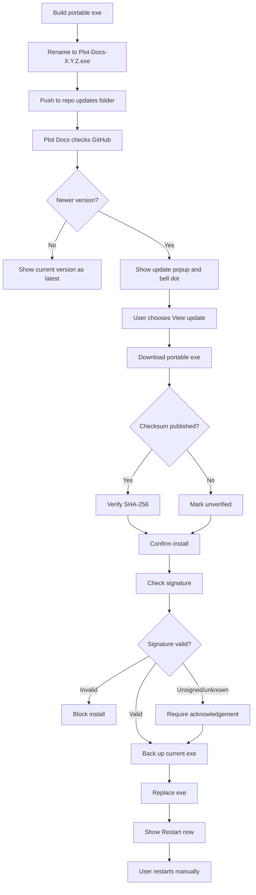
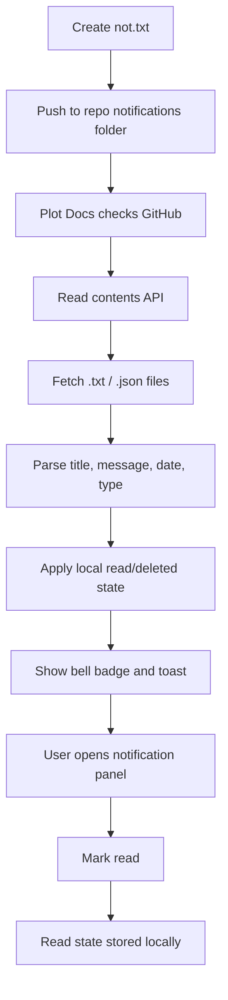

# GitHub Update and Notification Flow

This document explains the exact GitHub workflow for publishing a new Plot Docs build or a notification. It is the operational companion to `docs/updates-and-notifications.md`.

Plot Docs uses two GitHub-backed channels:

| Channel | Repository location | What it does |
| --- | --- | --- |
| Update | `updates/` folder, or a GitHub Release | Detects a newer portable `.exe` and offers the in-app update flow |
| Notification | `notifications/` folder | Turns `.txt` / `.json` files into in-app notifications |

The app checks GitHub on launch, when the user presses **Check**, and on window focus (at most once every 15 minutes). It does not run a continuous polling loop.

## 1. Publish a new update from the `updates/` folder

### Minimum workflow

1. Build the portable executable.
2. Rename it so the version is in the file name, for example `Plot-Docs-1.0.1.exe`.
3. Commit and push it to the `updates/` folder on the default branch.
4. Users who open Plot Docs (or press **Check**) see an update popup for `v1.0.1`.



### Recommended workflow with checksum and notes

Add an `update.json` manifest next to the executable:

```json
{
  "version": "1.0.1",
  "file": "Plot-Docs-1.0.1.exe",
  "sha256": "0123456789abcdef0123456789abcdef0123456789abcdef0123456789abcdef",
  "releaseNotes": "Fixes the update center and improves large-data imports.",
  "publishedAt": "2026-11-09T12:00:00.000Z"
}
```

The app reads every non-example `*.json` file in `updates/`, matches the manifest to the package by `file`, and uses the manifest for the version, checksum, notes, and publish date. A manifest without `file` applies to every package in the folder.

The checksum is computed with:

```powershell
Get-FileHash .\Plot-Docs-1.0.1.exe -Algorithm SHA256
```

Use the lowercase hex digest in `sha256`.

### How the app chooses between a release and the folder

The app checks both:

- `GET /repos/{owner}/{repo}/releases/latest`
- `GET /repos/{owner}/{repo}/contents/updates`

It chooses the newer version. If both have the same version, it prefers a release with a portable asset; otherwise it prefers the folder's portable executable. Installer-only assets remain download-only.

### Why the exe must be portable

Only a portable `.exe` can replace the running executable. A setup/installer file is downloaded and shown in the panel, but Plot Docs never executes it automatically.

### Repository size note

GitHub repositories are not a CDN. For large binaries, the best long-term strategy is a GitHub Release asset. The `updates/` folder workflow is intentionally supported because it is the simplest "push a file and everyone gets the popup" workflow, but a release is more efficient for many users.

## 2. Publish a notification from the `notifications/` folder

### Minimum workflow

1. Create `not.txt`.
2. Write the notification text.
3. Commit and push it to `notifications/` on the default branch.
4. Users see the notification in the bell panel after the next GitHub check.



### Plain text

```text
Maintenance tonight

Plot Docs will be read-only from 18:00 to 18:30 UTC.
```

The first non-empty line becomes the title; the rest becomes the message. A leading Markdown heading marker is removed.

### Header format

```text
Title: Maintenance tonight
Type: warning
Date: 2026-11-09T18:00:00Z

Plot Docs will be read-only from 18:00 to 18:30 UTC.
```

### Frontmatter format

```text
---
title: Maintenance tonight
type: warning
date: 2026-11-09T18:00:00Z
---

Plot Docs will be read-only from 18:00 to 18:30 UTC.
```

Supported types: `info`, `success`, `warning`, `error`, `update`.

### JSON files

`.json` files work exactly as they do in the local notifications folder. A `.json` file may contain one object, an array, or `{ "notifications": [...] }`.

### Remote notification behavior

- Remote notifications can be marked read.
- The local read state is stored in `notifications/state.json`.
- Remote notifications cannot be deleted from the desktop app, because that would require write access to the GitHub repository. The delete button is hidden for remote items.
- If the file content changes, the new content becomes unread again.
- Undated remote notifications keep the first-seen date so they do not become unread on every check.

### Ignored files

- dotfiles
- `state.json`, `read-state.json`
- `*.example.json`, `*.sample.json`
- `*.example.txt`, `*.sample.txt`
- files over 1 MB
- malformed JSON

## 3. Configuration

| Environment variable | Purpose |
| --- | --- |
| `PLOTDOCS_GITHUB_REPO` | `owner/repo`; defaults to `sukhee-2626/plot-docs` |
| `PLOTDOCS_GITHUB_TOKEN` / `GITHUB_TOKEN` / `GH_TOKEN` | Optional token for private repositories or higher rate limits |
| `PLOTDOCS_UPDATES_DIR` | Absolute local updates folder |
| `PLOTDOCS_NOTIFICATIONS_DIR` | Absolute local notifications folder |

## 4. Security rules

- The renderer never supplies a URL or path. It sends opaque package ids or a folder kind.
- The main process resolves the GitHub repository, folder, file name, and download URL.
- Only GitHub hosts and `*.githubusercontent.com` are accepted for downloads.
- A published SHA-256 must match before install.
- Invalid signatures are blocked.
- Unsigned or unknown signatures require an explicit acknowledgement.
- The current executable is backed up before replacement.
- The app never restarts without the user pressing **Restart now**.
- Installers are never executed automatically.
- User documents and settings are not touched.

## 5. Testing the flow locally

The focused unit tests use a mock GitHub API:

```powershell
npx vitest run apps/shell/tests/updates-center-core.test.ts apps/shell/tests/updates-center-github-folders.test.ts
```

The folder test covers:

- a repository `updates/Plot-Docs-1.0.1.exe`
- a matching `update.json` checksum
- a repository `notifications/not.txt`
- download, checksum verification, signature check, backup, replacement, and restart-required state
- choosing a newer release over an older folder package

For a live check, push a real file and use **Check** in the panel. The app never polls continuously, so the panel's manual check is the fastest way to verify a new push.
